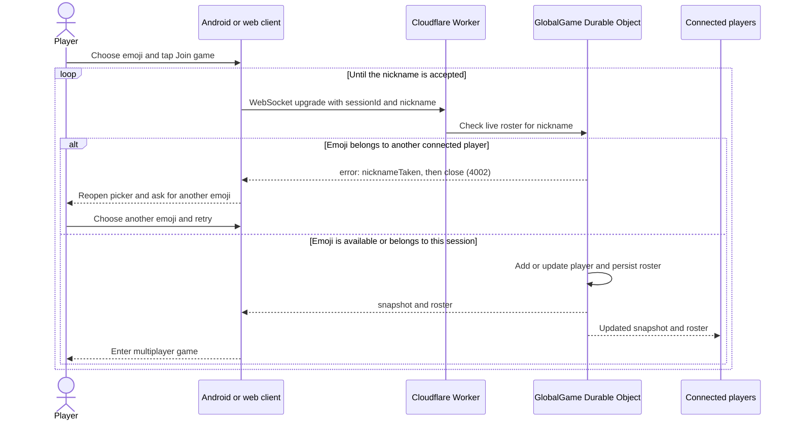

[](https://github.com/shahart/fizz-buzz/actions/workflows/static.yml)

[](https://github.com)

# fizz-buzz 7-boom

A global number game with a lightweight HTML/CSS/TypeScript web client and a Compose Multiplatform Android app. One Cloudflare Durable Object owns the shared counter, player rotation, and seven-second deadline. Tap or say the displayed number, or say `BOOM`/tap 💣 when it is divisible by 7 or contains the digit 7.

## Run

Use JDK 17 through 24.

```bash
# From the repository root: install web dependencies and compile TypeScript
npm --prefix docs ci
npm --prefix docs run build

# Terminal 1: start the Worker and serve the web client
cd worker
npm ci
npm run dev
```

In another terminal, from the repository root:

```bash
# Run Android checks and build the debug APK
./gradlew :composeApp:allTests
./gradlew :composeApp:connectedDebugAndroidTest
./gradlew :composeApp:assembleDebug
```

Open `http://localhost:8787` in two browser windows to exercise the global rotation. The Worker serves the compiled static web client from `docs/` and the game WebSocket from `/game`; the browser client has no Compose, Kotlin, or WebAssembly runtime. Its TypeScript sources are in `docs/src/`: `app.ts` starts the client, while `render.ts`, `events.ts`, and `copy.ts` hold the UI rendering, input handling, and translations. `npm --prefix docs run build` compiles them to the ignored `docs/build/` directory.

### Tests

Run the Worker type-check, Durable Object tests, and web-client unit tests from the repository root:

```bash
npm --prefix worker ci
npm --prefix worker run check
```

Run the web-client unit tests and build with:

```bash
npm --prefix docs test
npm --prefix docs run build
```

Run the browser tests from `docs/`. They start a local static server and use Playwright Chromium with a mocked WebSocket, so no deployed Worker is needed. Build the web client first so the static server can load the compiled modules:

```bash
npx --prefix docs playwright install chromium
npm --prefix docs run test:browser
```

Add `-- --headed` to `npm --prefix docs run test:browser` to see Chromium perform the test actions. Run with `-- --workers=1` to watch the scenarios one at a time.

### Using pnpm

The same web and Worker commands are available through the repository pnpm workspace:

```bash
pnpm install --frozen-lockfile
pnpm --filter seven-boom-web-tests run build
pnpm --filter global-seven-boom-worker run check
pnpm --filter seven-boom-web-tests test
pnpm --filter seven-boom-web-tests run test:browser
```

Run the Android/Kotlin tests with:

```bash
./gradlew :composeApp:allTests
```

To run the Android Activity UI tests, start an Android emulator first, then run:

```bash
./gradlew :composeApp:connectedDebugAndroidTest
```

The Activity tests launch `MainActivity` and interact with its Compose UI. The GitHub Actions workflow runs the Worker/web tests and Android unit and emulator tests before deploying Pages.

The web client uses the deployed Worker for its WebSocket when hosted on GitHub Pages. When served by the local Worker on port `8787`, it uses that same local origin instead.

Android builds use `wss://global-seven-boom.lat-shahar.workers.dev/game` by default. To use the local Worker from an Android emulator instead, override the endpoint when building:

```bash
./gradlew :composeApp:assembleDebug -PgameWorkerUrl=ws://10.0.2.2:8787/game
```

The Wear OS module is currently excluded from Gradle builds. Android builds target the phone app in `:composeApp`.

## Firebase Analytics (Android)

The Android app includes Google Analytics for Firebase. To connect a build to the Firebase project:

1. Register the Android app `com.shahartal.fizzbuzz` in Firebase with Google Analytics enabled.
2. Download its `google-services.json` and save it as `composeApp/google-services.json`.
3. Rebuild and install the app. Firebase then records automatic events such as `first_open`, `session_start`, and `user_engagement`; no initialization code is required.

Use Analytics **DebugView** while verifying a debug build. In Google Analytics, demographic reporting is under **Reports > User attributes > Demographic details**. Age, gender, and interests are aggregated only when eligible device advertising identifiers/signals and the required user consent are available, and Google can withhold low-volume results using privacy thresholds. Configure consent and the Google Analytics data controls for every region where the app is offered before distributing the analytics-enabled build.

### Firebase Analytics (web)

The browser client loads the modular Firebase JavaScript SDK after the game UI is ready and is registered as the `fizzbuzz-web` app in the same Firebase project. Its public client configuration is stored in `docs/firebase-config.js`. The Android `google-services.json` cannot configure the web data stream because it does not contain the web app ID or Analytics measurement ID.

When `apiKey`, `appId`, and `measurementId` are present, Analytics starts automatically in supported browsers and records events such as `first_visit`, `page_view`, `session_start`, and `user_engagement`. With an incomplete config, Analytics stays disabled and the game continues normally. For web age, gender, and interest reporting, enable Google signals and implement the consent behavior required for the regions where the site is available.

Deploy the Worker with Wrangler from `worker/`:

```bash
cd worker
npx wrangler deploy
```

Or run the equivalent package script with `npm run deploy`. No account, credentials, room codes, or free-text player names are used. Each player chooses an unused nickname from the built-in emoji list; if another connected player already uses it, the Worker rejects the join and the player is prompted to choose another. The nickname is remembered in Android SharedPreferences or browser local storage and sent to the game Worker. At game over, the emoji belonging to the fastest average response-time rank is shown as the winner (including every rank-one emoji in a tie).

### Multiplayer join and nickname validation

Both clients submit the selected emoji as part of the WebSocket URL. The Worker checks it against the live roster before admitting a new player. A collision returns a typed WebSocket error and closes that attempt; the client reopens the picker with a localized prompt. A player's existing session may reconnect with its current emoji or change to an unused one.



The Android app opens its WebSocket and requests microphone access only after **Join game**. The browser client uses Web Speech when available; answer buttons work without speech support. Hiding the browser page or backgrounding Android leaves the roster and requires **Rejoin game** on return.

If the WebSocket cannot connect or an active connection is lost, the web and Android clients offer a local single-player round. The seven-second countdown starts only after the player acknowledges the offline message. Solo play supports voice and touch answers and saved records without requiring internet access.

